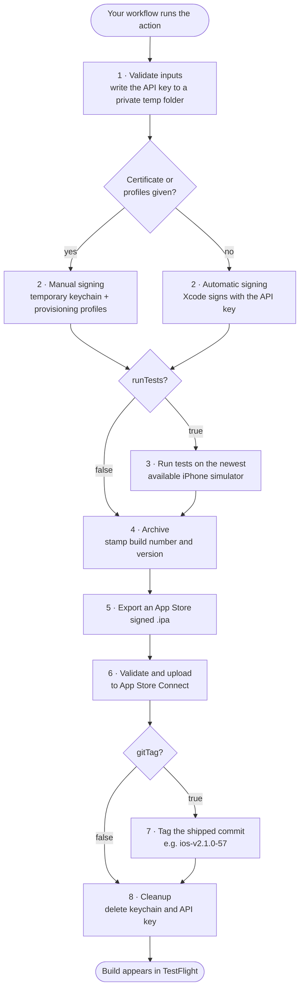
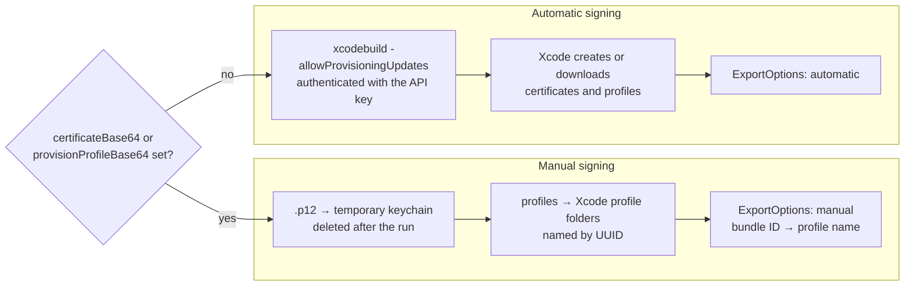
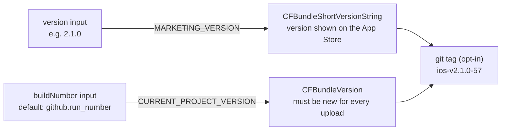
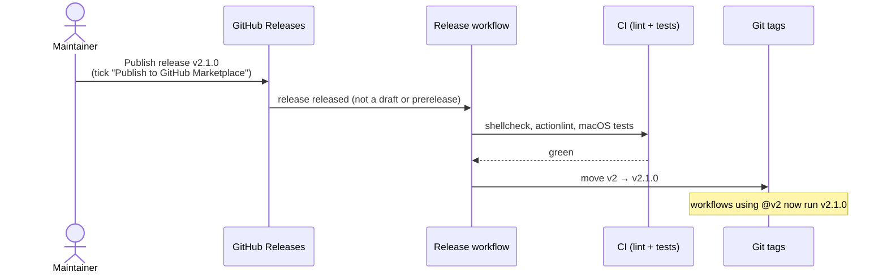

# Publish iOS Application to Appstore

[](https://github.com/UmutSERIFLER/publish-ios-appstore/actions/workflows/ci.yml)

A GitHub Action that takes an iOS project from source to **App Store Connect** in one step. It
tests, archives, signs, exports and uploads the build, and can tag the commit it shipped. The
build then appears in **TestFlight**, ready for testers or App Store review.

- **Two signing modes:** your own certificate and profiles, or fully automatic signing with an
  App Store Connect API key.
- **A fresh build number on every run**, so uploads are never rejected as duplicates.
- **Safe with secrets:** inputs never reach shell code directly, and the private key and API key
  are deleted after every run, even a failed one.
- **Works with projects and CocoaPods workspaces**, including multiple targets such as widgets
  and app extensions.

## Contents

- [How it works](#how-it-works)
- [Quick start](#quick-start)
- [Signing: manual or automatic](#signing-manual-or-automatic)
- [Versions, build numbers and git tags](#versions-build-numbers-and-git-tags)
- [Inputs](#inputs) · [Outputs](#outputs)
- [Self-hosted runners](#self-hosted-runners)
- [Troubleshooting](#troubleshooting)
- [Migrating from v1](#migrating-from-v1)
- [Releases of this action](#releases-of-this-action)
- [Development](#development)

## How it works



Cleanup (step 8) **always runs**, also when an earlier step fails, so secrets never stay on
the runner. If it cannot delete something, it still tries the rest, then fails the job and
names what is left. If any other step fails, the steps after it are skipped and the job fails.

| Step | What happens | Script |
| --- | --- | --- |
| 1. Validate | Checks the inputs and picks `-workspace` or `-project`, the scheme and the build number. Writes the `.p8` key with `600` permissions into a per-run temp folder. | [`setup.sh`](scripts/setup.sh) |
| 2. Signing | **Manual:** imports the `.p12` into a new temporary keychain and installs each profile. **Automatic:** skipped; Xcode fetches what it needs in step 4. | [`signing.sh`](scripts/signing.sh) |
| 3. Tests | `xcodebuild test` on the newest installed iPhone simulator, or on `testDestination`. | [`run-tests.sh`](scripts/run-tests.sh) |
| 4. Archive | `xcodebuild clean archive` with `CURRENT_PROJECT_VERSION`, plus `MARKETING_VERSION` and `DEVELOPMENT_TEAM` when you set them. | [`archive.sh`](scripts/archive.sh) |
| 5. Export | Generates `ExportOptions.plist`, maps each bundle ID to its profile, and exports the `.ipa`. | [`export.sh`](scripts/export.sh) |
| 6. Upload | `altool --validate-app`, then `altool --upload-app`. | [`upload.sh`](scripts/upload.sh) |
| 7. Git tag | Optional. Pushes an annotated tag for the commit that was uploaded. | [`tag.sh`](scripts/tag.sh) |
| 8. Cleanup | Deletes the temporary keychain, the API key and the decoded certificate. | [`cleanup.sh`](scripts/cleanup.sh) |

## Quick start

### 1. Create an App Store Connect API key

App Store Connect → **Users and Access** → **Integrations** → **App Store Connect API** →
**Team Keys** → **+**.

- **Role:** *App Manager* is enough for manual signing. Automatic signing needs *Admin*.
- **Download `AuthKey_<KEY_ID>.p8`.** Apple lets you download it only once.
- **Note the Key ID** (next to the key) and the **Issuer ID** (above the list).

### 2. Export your signing files (manual signing only)

Skip this step if you use [automatic signing](#signing-manual-or-automatic).

- **Certificate:** in Keychain Access → *My Certificates*, right-click
  **Apple Distribution: …** → **Export** → save as `.p12` and set a password.
- **Provisioning profile:** go to [developer.apple.com](https://developer.apple.com/account/resources/profiles/list)
  → **Profiles** → **+** → **App Store Connect**. Pick your App ID and the distribution
  certificate, then download the `.mobileprovision`. Create one profile for every target that
  gets signed (app, widget, extensions).

### 3. Add repository secrets

Use **Settings → Secrets and variables → Actions → New repository secret**, or the GitHub CLI:

```sh
gh secret set APPSTORE_API_KEY < AuthKey_ABC123DEF4.p8   # the .p8 contents as-is
gh secret set APPSTORE_API_KEY_ID --body "ABC123DEF4"
gh secret set APPSTORE_API_ISSUER --body "69a6de70-0000-47e3-e053-5b8c7c11a4d1"

# Manual signing only
base64 -i Certificates.p12 | gh secret set DISTRIBUTION_CERTIFICATE_BASE64
gh secret set DISTRIBUTION_CERTIFICATE_PASSWORD --body "the .p12 password"
base64 -i MyApp_AppStore.mobileprovision | gh secret set APPSTORE_PROFILE_BASE64
```

> On Linux, use `base64 -w0`. Wrapped base64 works for a single profile, but several profiles
> must each be on one line.

### 4. Add the workflow

`.github/workflows/testflight.yml`: every `v*` tag you push ships a TestFlight build.

```yaml
name: TestFlight

on:
  push:
    tags: ['v*']                     # e.g. git tag v2.1.0 && git push --tags

permissions:
  contents: read

jobs:
  publish:
    runs-on: macos-15
    steps:
      - uses: actions/checkout@v5

      - name: Read version from the tag
        id: meta
        run: echo "version=${GITHUB_REF_NAME#v}" >> "$GITHUB_OUTPUT"   # v2.1.0 -> 2.1.0

      - uses: UmutSERIFLER/publish-ios-appstore@v2
        id: publish
        with:
          projectName: MyApp                       # MyApp.xcodeproj, scheme MyApp
          version: ${{ steps.meta.outputs.version }}
          appstoreAPIKey: ${{ secrets.APPSTORE_API_KEY }}
          appstoreAPIKeyID: ${{ secrets.APPSTORE_API_KEY_ID }}
          appstoreAPIIssuer: ${{ secrets.APPSTORE_API_ISSUER }}
          certificateBase64: ${{ secrets.DISTRIBUTION_CERTIFICATE_BASE64 }}
          p12FilePassword: ${{ secrets.DISTRIBUTION_CERTIFICATE_PASSWORD }}
          provisionProfileBase64: ${{ secrets.APPSTORE_PROFILE_BASE64 }}

      - uses: actions/upload-artifact@v4          # keep the .ipa with the run
        with:
          name: MyApp-${{ steps.publish.outputs.buildNumber }}
          path: ${{ steps.publish.outputs.ipaPath }}
```

### 5. Ship it

Push a tag. The build shows up in App Store Connect → **TestFlight**, usually within minutes,
after Apple finishes processing it.

## Signing: manual or automatic

The action picks the mode from the inputs you pass:



| | Manual signing | Automatic signing |
| --- | --- | --- |
| Inputs | `certificateBase64`, `p12FilePassword`, `provisionProfileBase64` | none, optionally `teamID` |
| Xcode project setting | *Automatically manage signing* off, each target selects its profile | *Automatically manage signing* on |
| API key role | App Manager | Admin |
| Best for | Full control and shared self-hosted Macs | Fastest setup on GitHub-hosted runners |

For **several targets** (app, widget, extensions), pass all profiles in one input. Each
profile's bundle ID is read from the profile itself:

```yaml
          provisionProfileBase64: |
            ${{ secrets.APP_PROFILE_BASE64 }}
            ${{ secrets.WIDGET_PROFILE_BASE64 }}
```

For **automatic signing**, leave out the signing inputs. Set `teamID` if the project does not
save a development team; the action passes it to the archive as `DEVELOPMENT_TEAM`.

```yaml
      - uses: UmutSERIFLER/publish-ios-appstore@v2
        with:
          workspace: ios/MyApp.xcworkspace           # CocoaPods
          scheme: MyApp Production
          teamID: ABCDE12345
          appstoreAPIKey: ${{ secrets.APPSTORE_API_KEY }}
          appstoreAPIKeyID: ${{ secrets.APPSTORE_API_KEY_ID }}
          appstoreAPIIssuer: ${{ secrets.APPSTORE_API_ISSUER }}
```

## Versions, build numbers and git tags

An iOS build carries two numbers. The action can stamp both and turn them into a git tag:



- **Version (`version`)** is the version users see. Leave it empty to keep the project's
  value.
- **Build number (`buildNumber`)** must never repeat within one version. App Store Connect
  rejects re-used numbers. The default, `github.run_number`, grows on every run. If your app
  already has higher build numbers, pass one yourself, e.g. `buildNumber: 1000${{ github.run_number }}`.
- **Info.plist requirement:** `CFBundleVersion` must be `$(CURRENT_PROJECT_VERSION)` and
  `CFBundleShortVersionString` must be `$(MARKETING_VERSION)`. This is the default for projects
  created with Xcode 13 or later. If the archive ends up with a different build number, the
  action prints a warning.

### Tagging the shipped commit

With `gitTag: true`, a successful upload is followed by an annotated tag on the built commit,
pushed to `origin`. You can always see which commit produced which TestFlight build.

```yaml
permissions:
  contents: write                         # needed to push the tag

# ...
      - uses: UmutSERIFLER/publish-ios-appstore@v2
        with:
          gitTag: true
          gitTagName: 'testflight/{version}/{build}'   # optional, default ios-v{version}-{build}
          # ...other inputs
```

- **What gets tagged:** the checked-out commit of the repository that contains your
  `workspace`/`project`, also when it is a second checkout (`actions/checkout` with `path:`).
  The version and build come from the archive, so the tag matches what was really uploaded.
- **No upload, no tag:** with `uploadApp: false`, no tag is created.
- **Existing tags are never moved:** the step checks `origin`, so the default shallow checkout
  without tags is enough. If the tag already points at the same commit, the step is a no-op
  (re-runs succeed). If it points at a different commit, the step fails.
- **No workflow loops:** tags pushed with the default `GITHUB_TOKEN` do not start other
  workflows, so an `ios-v*` tag does not trigger your `v*` workflow.

## Inputs

**App Store Connect API (required)**

| Input | Description |
| --- | --- |
| `appstoreAPIKey` | Contents of `AuthKey_<id>.p8`, or its base64 encoding. |
| `appstoreAPIKeyID` | Key ID. |
| `appstoreAPIIssuer` | Issuer ID. |

**Project**

| Input | Default | Description |
| --- | --- | --- |
| `projectName` | | Project name without extension. Default for `project` and `scheme`. |
| `workspace` | | Path to an `.xcworkspace`. Takes precedence over `project`. |
| `project` | `<projectName>.xcodeproj` | Path to the `.xcodeproj`. |
| `scheme` | `projectName` | Scheme to test and archive. |
| `configuration` | `Release` | Build configuration of the archive. |

**Signing**

| Input | Default | Description |
| --- | --- | --- |
| `certificateBase64` | | Base64 of the Apple Distribution `.p12`. Omit for automatic signing. |
| `p12FilePassword` | | Password of the `.p12`. |
| `provisionProfileBase64` | | Base64 App Store profile(s), separated by commas or newlines. |
| `keychainPassword` | random | Password of the temporary keychain. |
| `teamID` | from project | 10-character team ID. Sets `DEVELOPMENT_TEAM` for the archive. |
| `mobileProvision` | | Deprecated and ignored. Profile names are read from the profiles. |

**Versioning and tagging**

| Input | Default | Description |
| --- | --- | --- |
| `version` | project value | `CFBundleShortVersionString`, e.g. `2.1.0`. |
| `buildNumber` | `github.run_number` | `CFBundleVersion`, one to three integers, e.g. `57` or `2.1.57`. |
| `gitTag` | `false` | Push a git tag for the uploaded commit. |
| `gitTagName` | `ios-v{version}-{build}` | Tag name template. |

**Tests, export and upload**

| Input | Default | Description |
| --- | --- | --- |
| `runTests` | `true` | Run tests first. Set `false` if the scheme has no test action. |
| `testDestination` | newest iPhone simulator | Any `xcodebuild -destination` value. |
| `exportMethod` | `app-store-connect` | Use `app-store` on Xcode older than 15.3. |
| `validateApp` | `true` | Validate before uploading. |
| `uploadApp` | `true` | `false` builds the `.ipa` without uploading it (dry run). |
| `extraXcodebuildArgs` | | Extra arguments for test (including simulator discovery) and archive, separated by spaces or newlines (a YAML `\|` block works), e.g. `-skipMacroValidation` or `-scmProvider system`. Test-only flags such as `-testPlan` are rejected by archive. Shell quoting is not supported. |

## Outputs

| Output | Description |
| --- | --- |
| `ipaPath` | Absolute path of the exported `.ipa`. |
| `archivePath` | Absolute path of the `.xcarchive`, including dSYMs for crash reporting. |
| `buildNumber` | Build number (`CFBundleVersion`) read back from the archive, so it is the real one even if the override did not apply. |
| `gitTag` | Tag pushed for the uploaded commit; empty unless `gitTag` is `true`. |

## Self-hosted runners

Each run keeps its secrets and build output in its own folder under `$RUNNER_TEMP`. One thing
is shared by all jobs of a macOS user: the **keychain search list**. Two runners under the same
user that start signing at the same instant can overwrite each other's update, so give each
runner its own macOS user.

| Asset | Lifetime |
| --- | --- |
| Certificate and private key | Only in the run's temporary keychain. The keychain is deleted at the end, and your login keychain stays in the search list. |
| API key (`.p8`) | Run folder only; deleted at the end. |
| Provisioning profiles | Installed by UUID and **kept**. They contain no secrets, and deleting them could break a parallel run that still needs them. |
| Archive and `.ipa` | Kept in `$RUNNER_TEMP` for later steps; the runner clears the folder between jobs. |

**Automatic signing caveat:** Xcode itself may create an *Apple Development* certificate in
the default (login) keychain, and the action cannot scope that safely. Switching default
keychains would break parallel jobs. On shared self-hosted Macs, prefer manual signing.

## Troubleshooting

| Message | Cause and fix |
| --- | --- |
| *The bundle version must be higher than the previously uploaded version* | The build number was already used. Pass a higher `buildNumber`. |
| `Archived CFBundleVersion is '1', not '57'` (warning) | `Info.plist` hardcodes `CFBundleVersion`. Set it to `$(CURRENT_PROJECT_VERSION)`. |
| *Scheme … is not currently configured for the test action* | The scheme has no tests. Set `runTests: false`. |
| *No iPhone simulator is available for scheme …* | No simulator runtime is installed. Set `testDestination`, or pick another Xcode. |
| *Signing for "…" requires a development team* | Automatic signing without a team. Set `teamID`. |
| *No provisioning profile … matches the app bundle id* (warning) | The profile is for a different App ID. Download the profile for the bundle ID shown in the warning. |
| *exportOptionsPlist error for key "method" … found app-store-connect* | Xcode older than 15.3. Set `exportMethod: app-store`. |
| *Could not push tag …* | Add `permissions: contents: write` to the job and keep the default `actions/checkout` credentials. |
| *Tag … already exists on …* | The tag name was used for another commit. Change `buildNumber` or `gitTagName`. |

To pick an Xcode version, add `sudo xcode-select -s /Applications/Xcode_16.4.app` before the
action. The images list which Xcode versions each runner has.

## Migrating from v1

- **Inputs:** every v1 input still works. `mobileProvision` is now ignored with a warning, and
  `teamID`, `certificateBase64`, `p12FilePassword`, `provisionProfileBase64` and
  `keychainPassword` are optional.
- **Build numbers:** v1's "+1" changed only the archive's metadata, so the uploaded app kept its
  old `CFBundleVersion`. v2 stamps `github.run_number`. Pass `buildNumber` if you need a
  higher number.
- **Simulator:** tests run on the newest installed iPhone simulator. v1 used
  `iPhone 14 Pro (iOS 16.2)`, which current runners no longer have.
- **Build output:** the archive and `.ipa` now live in `$RUNNER_TEMP`. Use the `archivePath`
  and `ipaPath` outputs.

## Releases of this action

Use `@v2` to get every compatible fix automatically, or pin an exact release such as
`@v2.0.0`. The floating `v2` tag is moved by the [Release workflow](.github/workflows/release.yml):



- **Drafts and prereleases** never move `v2`. Turning a prerelease into a full release does.
- **Only forward:** `v2` moves only to a release newer than the one it points at, so
  publishing `v2.0.1` after `v2.1.0` leaves it on `v2.1.0`. Tags that never reached `v2`
  (a pushed `v2.3.0` without a release, a `v2.2.0` prerelease) do not block a `v2.1.1` hotfix.
- **New majors:** `v3.0.0` creates `v3` and leaves `v2` where it is.
- **Only tested code:** the workflow promotes a tag only if CI ran on that tag's commit.
- **Manual re-run:** in the Actions tab, run the Release workflow with
  **Use workflow from → Tags → v2.1.0** (or `gh workflow run release.yml --ref v2.1.0`).
  Started from a branch, it fails without touching `v2`.

## Development

```sh
make test   # full suite on macOS /bin/bash 3.2; xcodebuild, xcrun and gh are stubbed
make lint   # shellcheck + actionlint   (brew install shellcheck actionlint)
```

- [`action.yml`](action.yml) only wires inputs into [`scripts/`](scripts) through environment
  variables. A metadata test fails if any shell code reads `${{ inputs.* }}` directly.
- The keychain integration test runs only on CI (`CI=true`), because it changes the user's
  keychain search list.

## License

[MIT](LICENSE)
